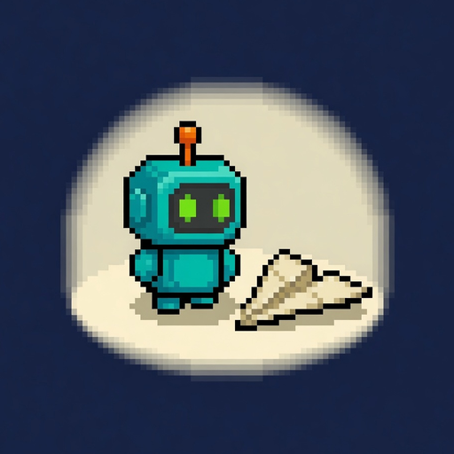
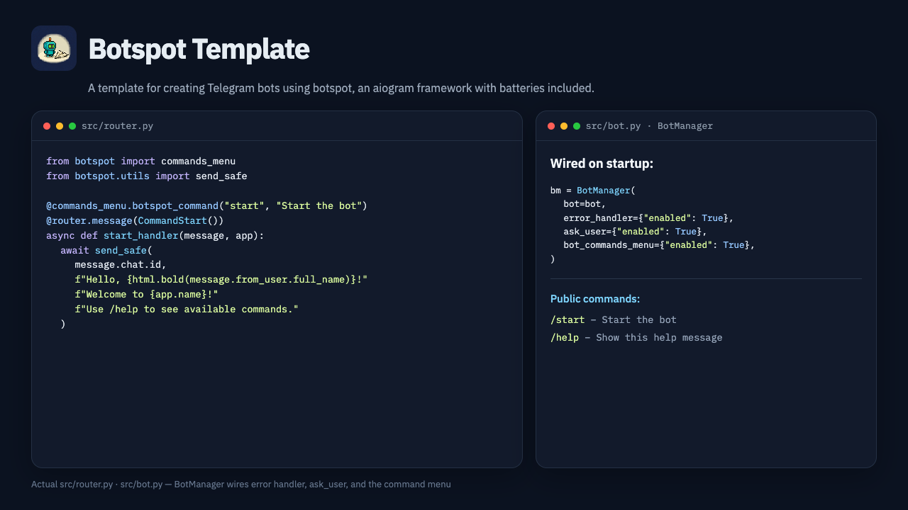

<h1 align="center">
   Botspot Template
</h1>

<p align="center">
  <strong>A template for creating Telegram bots using botspot, an aiogram framework with batteries included.</strong>
</p>

<p align="center">
  <a href="https://github.com/calmmage/botspot-template"></a>
  <a href="https://github.com/calmmage/botspot-template/actions/workflows/push-checks.yml"></a>
  <a href="LICENSE"></a>
  
  
</p>

<p align="center">
  <a href="https://github.com/calmmage/botspot"><kbd>botspot</kbd></a>
  &nbsp;
  <a href="https://docs.aiogram.dev"><kbd>aiogram</kbd></a>
  &nbsp;
  <a href="https://core.telegram.org/bots"><kbd>Telegram Bot API</kbd></a>
</p>

<h3 align="center"><a href="#install"><ins>Use this template</ins></a></h3>

<p align="center">
  <a href="docs/examples/hero.png"></a>
</p>

Clone, set a bot token, run. [botspot](https://github.com/calmmage/botspot) wires the command menu, error handler, and `send_safe` into your [aiogram](https://docs.aiogram.dev) dispatcher.

## Install

Needs **Python ≥ 3.12**, **[uv](https://docs.astral.sh/uv/)**, **make**, and a bot token from [@BotFather](https://t.me/BotFather).

GitHub: **[Use this template](https://github.com/calmmage/botspot-template/generate)**. Or clone:

```bash
git clone https://github.com/calmmage/botspot-template.git your-bot-name
cd your-bot-name
make setup                 # uv sync --group extras --group test
cp example.env .env        # set TELEGRAM_BOT_TOKEN
uv run python src/bot.py
```

`src/bot.py` is the entrypoint (Dockerfile uses the same command). Enable components in `.env`; see `example.env` for names.

**Agents:** follow **[botspot AGENTS.md](https://github.com/calmmage/botspot/blob/main/AGENTS.md)** for the library, and this repo's **[botspot_101.md](botspot_101.md)** for component snippets.

### Give this to an agent

Paste:

> Clone https://github.com/calmmage/botspot-template and follow **[README.md](README.md)**. Install [uv](https://docs.astral.sh/uv/) if missing. Do not invent an install path. A Telegram bot token from [@BotFather](https://t.me/BotFather) is the human's — put it in `.env` as `TELEGRAM_BOT_TOKEN`. Then `make setup` and `uv run python src/bot.py`.

## What you get

| Surface | What it is |
|---------|------------|
| **App** | `src/_app.py` — typed `AppConfig` (`TELEGRAM_BOT_TOKEN`) |
| **Bot** | `src/bot.py` — `BotManager` enables error handler, `ask_user`, command menu, then polling |
| **Router** | `src/router.py` — `@botspot_command` `/start` and `/help` |
| **Config** | `example.env` — component flags with `BOTSPOT_` prefixes |
| **Tests** | `make test` — `uv run pytest src tests` |
| **Docker** | `Dockerfile` runs `uv run python src/bot.py` |

## Project structure

```
.
├── src/
│   ├── _app.py          # AppConfig + App
│   ├── bot.py           # BotManager + polling entrypoint
│   ├── router.py        # /start and /help
│   └── __init__.py
├── docs/examples/       # logo, favicon, hero screenshot
├── example.env          # component flags (placeholders only)
├── botspot_101.md       # component snippets
├── Makefile             # setup / test
├── Dockerfile
└── pyproject.toml
```

## Docs

| | |
|---|---|
| This page, install, screenshot | [README.md](README.md) |
| In-repo docs index | [docs/index.md](docs/index.md) |
| Component snippets | [botspot_101.md](botspot_101.md) |
| Library + agent install | [calmmage/botspot](https://github.com/calmmage/botspot) · [AGENTS.md](https://github.com/calmmage/botspot/blob/main/AGENTS.md) |
| Vulnerability reports | [GitHub private advisories](https://github.com/calmmage/botspot-template/security/advisories/new) |

Docs stay in this repository and are linked from the README. GitHub Pages is not used.

```bash
make setup    # uv sync
make test     # pytest
```

## License

GPL-3.0 — see [LICENSE](LICENSE). Vulnerabilities: [GitHub private advisories](https://github.com/calmmage/botspot-template/security/advisories/new).
